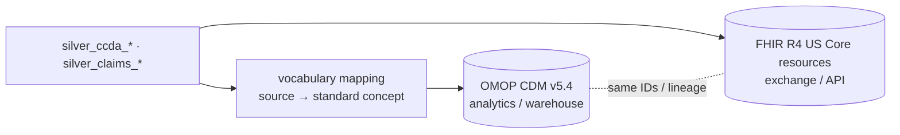

# Structuring the output for a Common Data Model (exam step 7)

The silver layer is designed as the **staging layer for a CDM**. It is already one row per clinical
statement, with source codes, code systems, dates and lineage separated out. Both OMOP and FHIR can be
produced from it without re-parsing XML.

**When to use which:** OMOP is an *analytical* model (person-centric, standardised vocabularies,
fast cohort queries). It suits the lakehouse/warehouse, actuarial work and model features. FHIR is an
*interoperability* model (resource graph, JSON, references). It suits APIs, exchange with partners, and
storing the clinical record closer to how it was sent. A common pattern is: land as FHIR (or C-CDA → FHIR),
analyse as OMOP.

## OMOP CDM v5.4

| OMOP table | Built from | Key mapping |
|---|---|---|
| `person` | `gold_patient_summary` + `silver_ccda_documents` | `person_source_value` = `patient_id`; `gender_concept_id` from `gender` (F → 8532, M → 8507); `year/month/day_of_birth` from the modal `birth_date`; race/ethnicity from `raceCode`/`ethnicGroupCode` (parser extension) |
| `observation_period` | min/max of all clinical + claim dates per person | Needed for OMOP-conformant analyses. Here it makes the clinical vs claims coverage gap explicit |
| `visit_occurrence` | `silver_claims_dx_lines` grouped by claim (IP → 9201 *Inpatient visit*, OP/professional → 9202 *Outpatient visit*; pharmacy fills → 581458 *Pharmacy visit*), plus one *document visit* per C-CDA | `visit_source_value` = `claim_id` / `document_id` |
| `condition_occurrence` | `silver_ccda_problems` (`is_usable`) **and** `silver_claims_dx_diagnoses` | `condition_source_value` = SNOMED or ICD-10 code; `condition_source_concept_id` = source vocab concept; `condition_concept_id` = standard SNOMED concept (ICD-10-CM → SNOMED via `concept_relationship` 'Maps to'); `condition_type_concept_id` = 32840 *EHR problem list* vs 32810 *Claim*; `condition_status_concept_id` from diag position (primary/secondary) or problem status; `condition_start_date` = onset (fallback: concern start or document date); `condition_end_date` = abatement |
| `drug_exposure` | `silver_ccda_medications` (`is_usable`) **and** `silver_claims_rx` | `drug_source_value` = RxNorm / NDC11; `drug_concept_id` = standard RxNorm (NDC → RxNorm via 'Maps to'); `drug_type_concept_id` = 32817 *EHR* vs 32869 *Pharmacy claim*; `days_supply`, `quantity`, `sig` (from `sig_text`), `route_concept_id` from `route`; start = `start_date` / `fill_date`, end = `end_date` / `supply_end_date` |
| `drug_era`, `condition_era` | derived from the above with the standard OHDSI era scripts | Medication persistence / chronic-condition duration features |
| `cost` | claim `billed/allowed/paid/patient_pay` | `cost_event_id` → visit / drug_exposure; `cost_domain_id` |
| `payer_plan_period` | claims `LOB`, `Product`, `ContractID` | Per member enrolment periods |
| `provider`, `care_site` | C-CDA `author/assignedAuthor`, claims `ProviderID`, `Specialty` | NPI where present (`root 2.16.840.1.113883.4.6`) |
| `note` (optional) | narrative sections | If NLP is added (see IMPROVEMENTS) |
| `cdm_source`, `metadata` | pipeline run metadata + DQ report | Version, run time, vocabulary version |

Concept IDs above are the standard OMOP/Athena IDs as I know them; the build should look them up from the loaded vocabulary rather than hard-code them.

Lineage: every OMOP row keeps the silver `document_id:entry_index` / `claim_id|line_num` in a
`*_source_value` or an extension table, so a value in a model can be traced back to the XML element.

**Implementation sketch on Databricks:** load the OHDSI Athena vocabulary tables (`concept`,
`concept_relationship`, `source_to_concept_map`) as Delta tables. Then do `JOIN … ON concept_code =
source_code AND vocabulary_id IN ('SNOMED','ICD10CM','RxNorm','NDC')` and follow 'Maps to' to the
standard concept. Unmapped source codes keep `concept_id = 0` and are reported. Validate with OHDSI
**Data Quality Dashboard** and **Achilles**.

## FHIR R4 (US Core)

C-CDA → FHIR has a published HL7 mapping (C-CDA on FHIR / the *C-CDA ↔ FHIR* IG). The silver columns map as follows:

| FHIR resource | From | Key elements |
|---|---|---|
| `Patient` | documents / summary | `identifier` (MemberID system), `gender`, `birthDate`, `address.state` |
| `DocumentReference` (+ `Composition` if storing the document) | `silver_ccda_documents` | `type` = LOINC 34133-9, `date`, `content.attachment.url` → bronze XML, `author` (software/org) |
| `Condition` | `silver_ccda_problems` | `category` = `problem-list-item` (or `encounter-diagnosis` for claim dx); `code.coding[]` = SNOMED **and** ICD-10 translations (FHIR allows several codings, which removes the need to pick one); `clinicalStatus` from `problem_status` (active/inactive/resolved/recurrence); `onsetDateTime`, `abatementDateTime`; `recordedDate` = author time; `meta.source` = document |
| `MedicationStatement` / `MedicationRequest` | `silver_ccda_medications` | `moodCode=INT` → `MedicationRequest` (intent=order), `EVN` → `MedicationStatement`; `medicationCodeableConcept.coding[]` = RxNorm + NDC + vendor codes; `status` from `status_code`; `effectivePeriod`; `dosage.text` = `sig_text`, `dosage.route`, `doseAndRate` |
| `MedicationDispense` | `silver_claims_rx` | `medicationCodeableConcept` = NDC (+ RxNorm), `whenHandedOver` = `fill_date`, `daysSupply`, `quantity` |
| `Claim` / `ExplanationOfBenefit` (CARIN Blue Button IG) | `silver_claims_dx_lines` | `diagnosis[]` with sequence = `diag_position`, `item[]` with HCPCS/rev code, `total`/`payment` amounts; pharmacy EOB for Rx |
| `Provenance` | lineage columns | Ties each resource to the source document and entry |

Storage in the lakehouse: either (a) a **FHIR server** (Azure Health Data Services, AWS HealthLake, HAPI)
fed by bundles generated from silver, with Bulk `$export` NDJSON landed back into Delta; or (b) **FHIR-shaped
Delta tables** (one table per resource type, nested `STRUCT/ARRAY` columns mirroring the resource, e.g. via
Databricks' `dbignite`). Option (b) keeps SQL analytics simple, and the same resources can still be served via an API.

## Why the silver layer is shaped this way
* **Source codes are kept with their system** (`snomed_code`, `icd10_code`, `rxnorm_code`, `ndc11`, plus the
  full `translations_json`). Both OMOP `*_source_value` and FHIR multi-coding need the original codes, not a single "best" code.
* **One row per statement with lineage.** OMOP `*_occurrence` / FHIR resources are also per statement, so the
  mapping is 1:1 and auditable. Dedup lives in gold, matching OMOP eras / FHIR "current list" views.
* **Dates are typed `DATE` with a fallback chain kept explicit** (`onset_date` vs `concern_start_date` vs
  `document_date`). OMOP requires a start date; the choice of fallback is a documented business rule, not lost in parsing.
* **Placeholders and negations are flagged, not deleted.** OMOP excludes them; FHIR could represent
  "no known problems" as a `List` with `emptyReason`.
