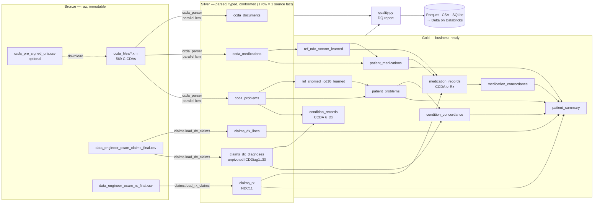

# Pipeline design (exam step 4)

## 1. What the submitted pipeline does



| Step | Module | What happens | Key decisions |
|---|---|---|---|
| 0. Land | `ccda_ingest.download_from_presigned_csv` | Optional: fetch each pre-signed URL into `ccda_files/` | Idempotent (skip existing), per-file error isolation, because signed URLs expire mid-run |
| 1. Parse C-CDA | `ccda_parser.parse_document` | One XML → 1 document row + N medication rows + N problem rows | Sections by **templateId or LOINC code**; names resolved from `displayName` → `<name>` → `originalText` → `#reference` into narrative; all translations kept as JSON; a bad file is quarantined, never fatal |
| 2. Conform claims | `claims.py` | Type dates/amounts, unpivot 30 diagnosis columns, normalise NDC to 11 digits | Keep the ~200 actuarial columns in bronze, carry a clinical/financial subset forward |
| 3. Normalise codes | `normalize.py` | ICD-10 (strip dots/upper), NDC (4-4-2/5-3-2/5-4-1 → 5-4-2), drug-name keys | Ambiguous 10-digit un-hyphenated NDCs are set to NULL rather than guessed |
| 4. Learn crosswalks | `combine.learn_*`, `fill_rxnorm_from_translations` | Mine SNOMED↔ICD-10, NDC↔RxNorm and vendor-code↔RxNorm pairs that EHRs already put in `<translation>` | Same-patient mapping first, then majority vote by *distinct patients* (not entries); ambiguous → NULL. ICD-10 coverage 25% → 70%, RxNorm 80% → 82%, no licensed terminology |
| 5. Optional RxNav | `terminology.py` (`--rxnav`) | NDC → RxCUI → ingredient | Cached JSON → deterministic re-runs; circuit-breaker if NLM is unreachable |
| 6. Deduplicate | `combine.dedupe_*` | 12.7k med entries → 1.8k patient-drugs; 8.3k problems → 1.1k patient-problems | Key = RxNorm/SNOMED, else NDC/ICD-10, else normalised name; *latest document wins* for status |
| 7. Combine | `combine.*_records`, `*_concordance` | UNION clinical + claims into one schema; full-outer-join per patient × code | Concordance at exact-code **and** ICD-10 category level |
| 8. Validate | `quality.py` | 27 checks (keys, parse failures, coverage, upstream defects) | `--strict` fails the run on any `error` check → usable as a CI/CD or workflow gate |
| 9. Load | `load.py` | Parquet (DATE types, snappy), CSV, SQLite | Parquet is Delta-ready; `databricks/01_load_to_delta.py` creates UC tables + PK constraints |

Run time: ~8 s for 569 documents (230 MB XML) on a laptop, parallel across CPUs.

## 2. How this runs in production on Databricks

The code is deliberately plain Python (pure functions per document) so the same parser runs in a unit
test, on a laptop, or inside Spark. Target design:

```mermaid
flowchart LR
    S3[(S3 / ADLS landing<br/>C-CDA XML + claims)] -->|Auto Loader<br/>cloudFiles binaryFile| B[bronze_ccda_raw<br/>path, content, ingest_ts]
    S3 -->|Auto Loader csv| BC[bronze_claims_*]
    B -->|mapInPandas(parse_document)<br/>distributed parse| SV[silver_ccda_*<br/>MERGE on document_id]
    BC --> SC[silver_claims_*<br/>MERGE on claim keys]
    SV & SC --> G[gold_* + concordance]
    G --> OMOP[cdm_omop.* / FHIR bundles]
    SV -.expectations.-> DQ[(DQ metrics table)]
    G --> BI[SQL Warehouse / dashboards / underwriting models]
```

* **Orchestration:** a Databricks Workflow (or Delta Live Tables / Lakeflow pipeline) with tasks
  `ingest_ccda → parse_ccda`, `ingest_claims → conform_claims` in parallel, then `build_gold → dq_gate → publish_cdm`.
  Airflow/ADF works the same way, calling the CLI.
* **Incremental & idempotent:** Auto Loader checkpoints track which files were seen; silver uses
  `MERGE INTO … ON document_id` (C-CDA file names already carry a content hash), so a re-sent document
  replaces rather than duplicates. Gold patient tables are rebuilt only for *patients touched* in the batch.
* **Distributed parse:** `spark.read.format("binaryFile")` → `mapInPandas` calling `parse_document` on the
  bytes. lxml releases the GIL and documents are independent, so this scales linearly with executors.
* **Data quality:** the checks in `quality.py` become DLT `expect`/`expect_or_drop` rules or a DQ task that
  writes metrics to a table; failing `error` checks block publication to gold.
* **Bad records:** malformed XML goes to a `quarantine` table with the error and the file path (this is
  already how `parse_status='failed'` works locally).
* **Lineage:** every silver/gold row carries `document_id` + `entry_index` (or `claim_id` + `line_num`),
  which together with Unity Catalog lineage traces any gold fact back to the exact XML element.
* **Security / PHI:** the C-CDAs contain names, addresses and phone numbers. Only the fields needed
  downstream are carried into silver (no names/addresses); raw bronze sits in a restricted schema with
  UC grants, and columns such as `birth_date` can be masked with UC column masks for non-privileged roles.
* **Schema evolution:** new C-CDA vendors/versions mostly add translations or move names; those land in
  `translations_json` and the name-source column without breaking schemas. `overwriteSchema`/`mergeSchema`
  is enabled for additive changes only.
* **CI/CD:** pytest on synthetic fixtures (no PHI in the repo's test data), then Databricks Asset Bundles
  to deploy the workflow to dev → prod.
